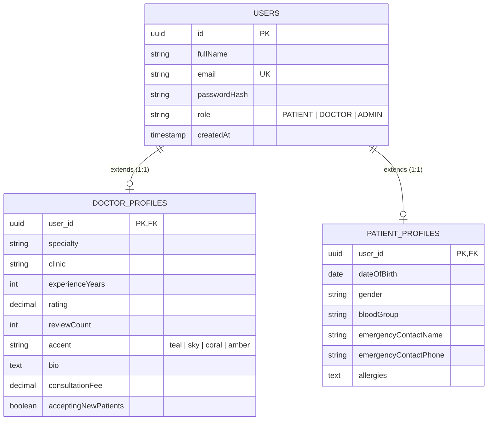

# MediConnect Backend — Phase 1 Technical Documentation
**Doctor & Patient Profiles, Discovery APIs, Database Seeding & Security**

---

## 1. Overview & Objectives

Phase 1 established the core domain entities, data access layers, services, and REST APIs for doctor discovery and patient profile management in MediConnect. It directly bridges the frontend UI (`FindDoctors.tsx`, `DoctorCard.tsx`, patient dashboards) with a live Spring Boot backend backed by JPA and Spring Security.

### Key Deliverables Completed:
- Extended user domain with **DoctorProfile** and **PatientProfile** entities using shared primary keys (`@MapsId`).
- Implemented **DoctorProfileRepository** and **PatientProfileRepository** with optimized queries.
- Built **DoctorService** and **PatientProfileService** with DTO mappers and validation.
- Exposed public REST endpoints for doctor discovery and specialty listings, alongside authenticated endpoints for profile updates.
- Configured **DatabaseSeeder** to pre-populate all 6 doctors from `mockData.ts` and a demo patient account.
- Updated **Spring Security** to permit unauthenticated browsing of doctor directories.
- Created end-to-end integration test suites ensuring 100% test pass rate.

---

## 2. Architecture & Domain Model

MediConnect employs a shared-key table design: the central `users` table holds authentication credentials and role assignments, while role-specific tables store domain-specific details.



### Key Technical Decision: `Persistable<UUID>`
In Spring Data JPA, when an entity uses `@Id` and `@MapsId` where the ID is known prior to insertion, `SimpleJpaRepository.save()` defaults to calling `entityManager.merge()` rather than `entityManager.persist()`. This causes Hibernate to attempt loading an existing row, resulting in an `AssertionFailure: null identifier`.

To resolve this cleanly:
- Both `DoctorProfile` and `PatientProfile` implement `Persistable<UUID>`.
- A `@Transient private boolean isNewEntity = true;` field is marked `false` upon `@PostPersist` / `@PostLoad`.
- This guarantees Spring Data JPA issues an `INSERT` (`persist()`) during creation and `UPDATE` (`merge()`) during subsequent edits.

---

## 3. API Reference

### 3.1 Doctor Discovery & Management (`/api/v1/doctors`)

| Method | Endpoint | Access | Description |
| :--- | :--- | :--- | :--- |
| `GET` | `/api/v1/doctors` | **Public** | Search and filter doctors by query text and/or specialty |
| `GET` | `/api/v1/doctors/specialties` | **Public** | Returns list of distinct specialties (prepended with `"All"`) |
| `GET` | `/api/v1/doctors/{id}` | **Public** | Get detailed profile of a specific doctor |
| `PUT` | `/api/v1/doctors/me` | **DOCTOR** | Update authenticated doctor's profile details |

#### Query Parameters for `GET /api/v1/doctors`:
- `query` (optional): Case-insensitive keyword search matching doctor's full name, specialty, or clinic name.
- `specialty` (optional): Exact specialty name (e.g. `Cardiology`) or `"All"`.

#### Doctor Response Format (`DoctorResponse`):
```json
{
  "success": true,
  "message": "Doctors retrieved successfully",
  "data": [
    {
      "id": "e2a1b940-0000-0000-0000-000000000001",
      "name": "Dr. Sarah Johnson",
      "email": "sarah.johnson@mediconnect.com",
      "specialty": "Cardiology",
      "clinic": "NYC Medical Center",
      "experienceYears": 15,
      "rating": 4.9,
      "reviewCount": 230,
      "nextSlot": "Today, 2:30 PM",
      "initials": "SJ",
      "accent": "teal",
      "bio": "Board-certified cardiologist specializing in preventive cardiology...",
      "consultationFee": 150.00,
      "acceptingNewPatients": true
    }
  ]
}
```

---

### 3.2 Patient Profile Management (`/api/v1/patients`)

| Method | Endpoint | Access | Description |
| :--- | :--- | :--- | :--- |
| `GET` | `/api/v1/patients/me` | **PATIENT** | Get authenticated patient profile |
| `PUT` | `/api/v1/patients/me` | **PATIENT** | Update authenticated patient demographics & medical details |
| `GET` | `/api/v1/patients/{id}` | **DOCTOR / ADMIN** | Lookup patient profile by ID (e.g. for clinical consults) |

#### Patient Profile Response Format (`PatientProfileResponse`):
```json
{
  "success": true,
  "message": "Profile retrieved successfully",
  "data": {
    "userId": "d1c2b3a4-0000-0000-0000-000000000099",
    "fullName": "Alex Rivera",
    "email": "alex.rivera@mediconnect.com",
    "dateOfBirth": "1994-05-15",
    "gender": "Male",
    "bloodGroup": "O+",
    "emergencyContactName": "Maria Rivera",
    "emergencyContactPhone": "+1-555-0199",
    "allergies": "Penicillin, Peanuts"
  }
}
```

---

## 4. Default Seed Data & Demo Accounts

On startup, `DatabaseSeeder` checks if doctor records exist. If empty, it creates the following demo accounts with BCrypt-hashed passwords (`password123`):

### 4.1 Seeded Doctors
| Name | Email | Specialty | Clinic | Rating | Accent | Fee |
| :--- | :--- | :--- | :--- | :---: | :---: | :---: |
| **Dr. Sarah Johnson** | `sarah.johnson@mediconnect.com` | Cardiology | NYC Medical Center | 4.9 (230) | `teal` | $150 |
| **Dr. Mark Lee** | `mark.lee@mediconnect.com` | Cardiology | NYC Medical Center | 4.9 (230) | `sky` | $140 |
| **Dr. Priya Nair** | `priya.nair@mediconnect.com` | Pediatrics | Riverside Clinic | 4.8 (142) | `coral` | $110 |
| **Dr. Elena Ruiz** | `elena.ruiz@mediconnect.com` | Dermatology | Westside Health | 4.7 (98) | `amber` | $125 |
| **Dr. Tom Whitfield** | `tom.whitfield@mediconnect.com` | Orthopedics | NYC Medical Center | 4.9 (310) | `sky` | $175 |
| **Dr. Amara Obi** | `amara.obi@mediconnect.com` | Neurology | Riverside Clinic | 4.8 (176) | `teal` | $160 |

### 4.2 Seeded Patient
- **Name:** Alex Rivera
- **Email:** `alex.rivera@mediconnect.com`
- **Password:** `password123`
- **Blood Group:** `O+` | **DOB:** `1994-05-15` | **Allergies:** `Penicillin, Peanuts`

---

## 5. Security & Authentication Updates

In `SecurityConfig.java`:
- Added `.requestMatchers(HttpMethod.GET, "/api/v1/doctors/**").permitAll()` to public route rules.
- Maintained strict `@PreAuthorize("hasRole('DOCTOR')")` on `PUT /api/v1/doctors/me`.
- Maintained strict `@PreAuthorize("hasRole('PATIENT')")` on patient self-service endpoints.
- Updated `AuthService.register()` so that newly registered users automatically get their associated `DoctorProfile` or `PatientProfile` initialized.

---

## 6. Testing & Quality Assurance

Integration test suites were executed using the Maven Wrapper (`./mvnw.cmd test`):

```
[INFO] Running com.mediconnect.backend.MediconnectApplicationTests
[INFO] Tests run: 1, Failures: 0, Errors: 0, Skipped: 0
[INFO] Running com.mediconnect.backend.profile.DoctorControllerTests
[INFO] Tests run: 5, Failures: 0, Errors: 0, Skipped: 0
[INFO] Running com.mediconnect.backend.profile.PatientProfileControllerTests
[INFO] Tests run: 2, Failures: 0, Errors: 0, Skipped: 0
[INFO] ------------------------------------------------------------------------
[INFO] BUILD SUCCESS - 8 Tests Run, 0 Failures, 0 Errors
[INFO] ------------------------------------------------------------------------
```

### Verified Test Cases:
1. `contextLoads()` — Context boots and JPA schema generation succeeds.
2. `testGetAllDoctors()` — Returns all seeded doctors.
3. `testGetSpecialties()` — Returns distinct specialty list with `"All"`.
4. `testFilterBySpecialty()` — Filters doctors by `"Cardiology"`.
5. `testSearchByQuery()` — Case-insensitive search on `"Ruiz"`.
6. `testUpdateDoctorProfile()` — Doctor login, JWT bearer extraction, and profile update via `PUT /api/v1/doctors/me`.
7. `testGetPatientProfile()` — Patient login and profile fetch via `GET /api/v1/patients/me`.
8. `testUpdatePatientProfile()` — Patient updates emergency contact & allergies via `PUT /api/v1/patients/me`.

---

## 7. Next Step: Phase 2 Roadmap

With Phase 1 complete, the backend is ready for **Phase 2: Appointments & Scheduling**:
1. **Appointment Entity**: Linking `patient` (`User`), `doctor` (`User`), `appointmentDate`, `timeSlot`, `status` (`upcoming`, `completed`, `cancelled`), `mode` (`In-person`, `Video call`), and `notes`.
2. **Appointment Repository**: Queries for doctor agenda and patient upcoming/past appointments with collision detection for double bookings.
3. **Appointment Service & Controller**:
   - `POST /api/v1/appointments` (Book slot)
   - `GET /api/v1/appointments/my` (Patient appointments list)
   - `GET /api/v1/appointments/doctor/my` (Doctor agenda)
   - `PATCH /api/v1/appointments/{id}/status` (Cancel or complete)
